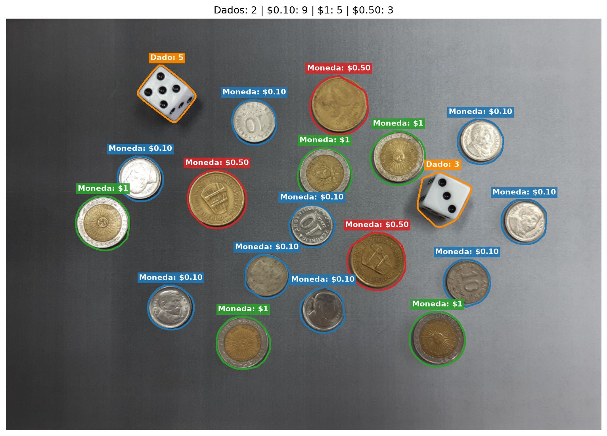
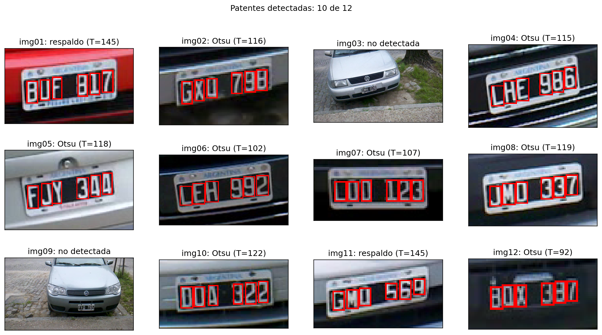

<div align="center">

# Procesamiento de Imágenes — Trabajo Práctico N°2

**Universidad Austral · Licenciatura en Ciencia de Datos · 2026**

**Segmentación y clasificación de monedas y dados · Detección de patentes**

</div>

---

## 👥 Integrantes

| Apellido y nombre |
|---|
| Castillo, Juan Ignacio |
| Fasolato, Matías |
| Torregiani, Bautista |

---

## 📌 Introducción

Este repositorio contiene la resolución del **Trabajo Práctico N°2 de Procesamiento de Imágenes**, compuesto por dos problemas:

| Problema | Descripción |
|---|---|
| **1 — Monedas y dados** | A partir de una imagen, segmentar los objetos, diferenciar monedas de dados, clasificar las monedas por denominación y contar los puntos visibles en la cara superior de cada dado. |
| **2 — Patentes de vehículos** | Localizar y recortar las patentes de un conjunto de 12 imágenes y segmentar sus caracteres, sin realizar reconocimiento de texto (OCR). |

---

## 📁 Estructura del proyecto

```text
TP2_PDI/
├── Patentes/
│   ├── img01.png                         # Imágenes del Problema 2
│   ├── ...
│   └── img12.png
├── Resultados/
│   ├── p2_original_gris.png              # Ejemplo de imagen original y en grises
│   ├── p2_umbralado_otsu.png             # Umbralización de la patente
│   ├── p2_patente.png                    # Localización y recorte de la patente
│   ├── p2_caracteres.png                 # Segmentación de caracteres
│   ├── p2_resumen.png                    # Resumen de las 12 imágenes
│   └── ...                               # Otras visualizaciones del Problema 2
├── venv_TP2_PDI/                         # Entorno virtual local (ignorado por Git)
├── .gitignore
├── monedas.jpg                           # Imagen del Problema 1
├── problema_1_monedas.py                # Resolución del Problema 1
├── Problema2_patentes.py                # Resolución del Problema 2
├── README.md
├── requirements.txt                      # Dependencias de Python
├── resultado_final.png                   # Resultado final del Problema 1
└── TUIA_PDI_TP2_2025_C2.pdf              # Consigna del trabajo práctico
```

> **Nota:** `venv_TP2_PDI/` se crea en cada computadora y no se sube al repositorio. Las imágenes de `Resultados/` son generadas por el script del Problema 2.

---

## ⚙️ Instalación

**1. Clonar el repositorio**

```bash
git clone https://github.com/MatiFasolato/TP2_PDI.git
cd TP2_PDI
```

**2. Crear un entorno virtual**

```bash
python3 -m venv venv_TP2_PDI
```

| Sistema | Comando de activación |
|---|---|
| Windows | `venv_TP2_PDI\Scripts\activate` |
| Linux / macOS | `source venv_TP2_PDI/bin/activate` |

**3. Instalar las dependencias**

```bash
python -m pip install -r requirements.txt
```

El proyecto utiliza **OpenCV**, **NumPy** y **Matplotlib**.

---

## ▶️ Ejecución

> [!IMPORTANT]
> Ejecutar ambos scripts **desde la carpeta raíz del repositorio**, porque las imágenes se cargan mediante rutas relativas.

### 🪙 Problema 1 — Monedas y dados

```bash
python problema_1_monedas.py
```

- **Entrada:** `monedas.jpg`.
- **Procesamiento:** reducción de escala, suavizado, gradiente de Sobel, umbralización, limpieza de componentes conectadas y operaciones morfológicas para completar cada objeto. Se utiliza la **circularidad** para separar dados de monedas y **k-means (`k=3`)** para agrupar las monedas según su área. Finalmente, se detectan y cuentan los puntos de la cara superior de los dados.
- **Salida:** visualizaciones intermedias, resultados por consola y la imagen etiquetada `resultado_final.png`.

**Resultados obtenidos con la imagen proporcionada:**

| Elemento | Cantidad / resultado |
|---|---|
| Dados | 2 (caras superiores: **5** y **3**; suma: **8**) |
| Monedas de $0.10 | 9 |
| Monedas de $1 | 5 |
| Monedas de $0.50 | 3 |
| **Total de objetos** | **19** |

**Resultado final:**



---

### 🚘 Problema 2 — Localización y segmentación de patentes

```bash
python Problema2_patentes.py
```

- **Entrada:** `Patentes/img01.png` a `Patentes/img12.png`.
- **Procesamiento:** conversión a escala de grises, umbralización con **Otsu** y un umbral de respaldo, identificación de componentes conectadas, filtrado por dimensiones y proporciones similares a las de los caracteres y agrupamiento de **seis caracteres alineados**. Con el grupo seleccionado se delimita la patente y se segmentan sus caracteres.
- **Salida:** información por consola sobre las patentes detectadas y figuras del proceso en `Resultados/`, incluido `p2_resumen.png` con el análisis de las 12 imágenes.

> El objetivo de este problema es **localizar las patentes y segmentar sus caracteres**; el código no busca reconocer las letras y los números mediante OCR.

**Resumen visual generado por el programa:**



